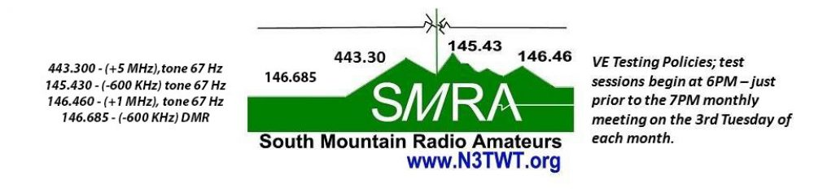
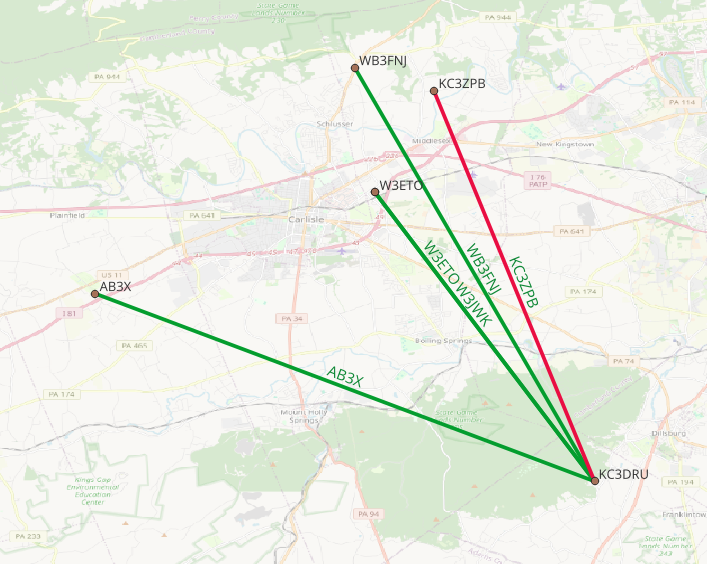
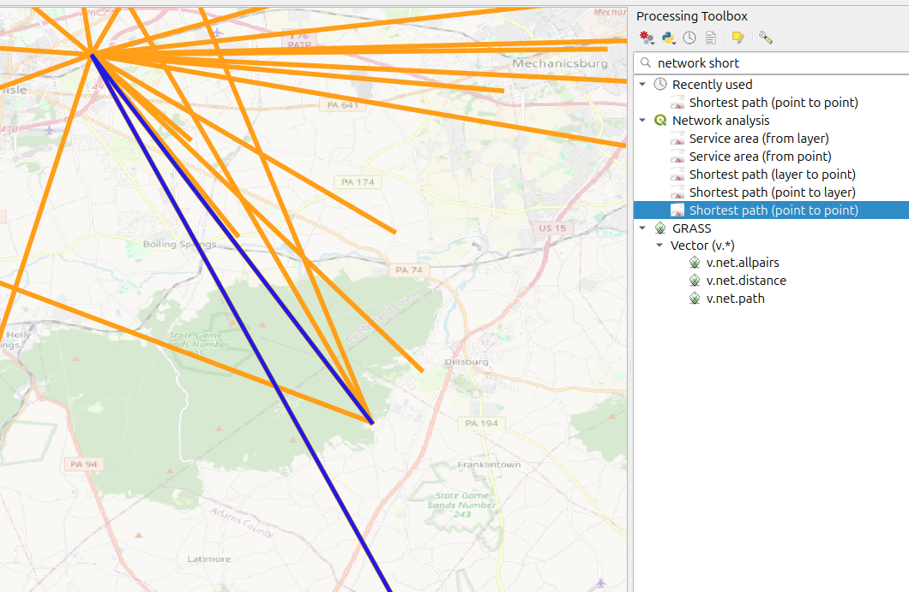

<div align="center">
  
</div>

<h1 align="center">EmComm Mapping Demo</h1>

<p align="center">
  <strong>QGIS for Emergency Communications — a starter kit for SMRA operators</strong><br>
  Who can talk to whom · Where stations and assets are · What happened after the net
</p>

<p align="center">
  <a href="https://www.qgis.org"></a>
  <a href="https://n3twt.org"></a>
  <a href="https://github.com/KC3DRU"></a>
  
  
  <a href="LICENSE"></a>
</p>

<p align="center">
  Companion files for the club presentation <em>“Intro to QGIS for Emergency Communications Mapping”</em>.<br>
  Clone this repo, open <code>EmComm_Planning_Map.qgz</code>, and you have a working map in about five minutes.
</p>

---

## Contents

- [What this is](#what-this-is)
- [Quick start](#quick-start)
- [What's in the repo](#whats-in-the-repo)
- [The sample project](#the-sample-project)
- [Make your own net map](#make-your-own-net-map)
- [Step-by-step walkthroughs](#step-by-step-walkthroughs)
- [Styling cheat sheet](#styling-cheat-sheet)
- [QGIS → CalTopo handoff](#qgis--caltopo-handoff)
- [The presentation](#the-presentation)
- [Notes & caveats](#notes--caveats)
- [Data sources worth knowing](#data-sources-worth-knowing)
- [Field tips](#field-tips)
- [Contributing & contact](#contributing--contact)
- [License & attribution](#license--attribution)

---

## What this is

A **real, working QGIS project** built from an actual SMRA exercise, packaged so any operator in the club can open it, follow along with the slides, and then point it at their own data.

During the **July 2026 simplex test** handled out of the Cumberland County EOC, the question was simple: *who could we actually hear?* A spreadsheet of callsigns and coordinates can answer that — a map answers it instantly.

<div align="center">
  
  <br><sub>Stations heard on the July 2026 net — one line per contact, radiating from the EOC.<br>
  Coordinates in this repo are fuzzed; see <a href="#notes--caveats">Notes &amp; caveats</a>.</sub>
</div>

**What QGIS is good for in EmComm:**

| Use it for | Reach for something else when |
| :-- | :-- |
| Custom situational maps — any layers you want | You need **live** APRS positions → YAAC, Xastir, APRSISCE |
| After-action maps for net and exercise reports | You need shared, mobile, real-time maps → CalTopo |
| Combining radio data + county GIS + OpenStreetMap | You need coverage prediction / radio-specific tooling |
| Rich symbology, labeling, print layouts (PDF/11×17) | — |

> QGIS **complements** live tracking tools; it does not replace them. Do the careful layer work in QGIS, then push the result to CalTopo for field sharing.

---

## Quick start

1. **Install QGIS** (free) from [qgis.org](https://www.qgis.org) — Windows, macOS, Linux, even Raspberry Pi. This project was saved with **QGIS 3.44 Solothurn**; any recent 3.x will open it.
2. **Clone or download** this repository:
   ```bash
   git clone https://github.com/KC3DRU/EmComm-Mapping-Demo.git
   cd EmComm-Mapping-Demo
   ```
   > Keep the folder structure intact — the project references data with **relative paths** (`./Layers/...`).
3. **Double-click** `EmComm_Planning_Map.qgz` (or QGIS → *Project → Open*).
4. **Toggle layers** in the Layers panel. Turn basemaps on/off to reduce visual noise — OSM, USGS Topo, and ESRI World Hillshade are all included.
5. **Frame the data**: right-click a layer → *Zoom to Layer*, or use the **Zoom to Full Extent** toolbar button to see everything at once.

> **Internet required** for the three basemaps (they are online XYZ tile services). Your radio layers work offline regardless — see [Field tips](#field-tips) for caching tiles ahead of a deployment.

---

## What's in the repo

```text
EmComm-Mapping-Demo/
├── .gitignore                             # Lock files, backups (keeps scratch data out)
├── LICENSE                                # CC BY-SA 4.0
├── EmComm_Planning_Map.qgz              # The QGIS project (layers, styles, CRS)
├── QGIS_EmComm_Mapping_Intro_v2.odp     # Club presentation (LibreOffice Impress)
├── QGIS_EmComm_Mapping_Intro_v2.pdf     # Same deck as PDF
├── Other_Instructions/                  # Written walkthroughs (PDF, with screenshots)
│   ├── Point-to-Point Contact Map.pdf   # Contact lines + station dots from a spreadsheet
│   └── Creating a Drive Route for CERT.pdf  # Valhalla routing + task-instruction layer
├── Layers/                              # Working data used by the project
│   ├── 20260716_EmComm_Net_EOC_South_Mountain.csv   # Net contacts as WKT linestrings
│   ├── OPERATORS.WKT                    # Station points (callsign + WKT POINT)
│   ├── EC_DRILL.WKT                     # Drill contacts (callsign + WKT + SIGNAL)
│   ├── Merged_Drill_Layers.geojson      # Merged input for network analysis
│   ├── ShortestPath.geojson             # Output of the Shortest Path tool
│   ├── N3TWT_Repeaters.*                # Club repeater points (ESRI Shapefile set)
│   └── TM Support Sites.sqlite          # County support-site points (SpatiaLite)
├── Exports/                             # Sample exports for sharing / CalTopo
│   ├── N3TWT_Repeaters.geojson
│   └── N3TWT_Repeaters.qmd              # QGIS layer definition metadata
└── assets/                              # Images used by this README
```

**Project CRS:** `EPSG:4326` (WGS 84) — the same lat/lon datum your GPS and APRS use.

---

## The sample project

| Layer | Geometry | Source file | What it shows |
| :-- | :-- | :-- | :-- |
| `20260716_EmComm_Net_EOC_South_Mountain` | Lines | `Layers/…csv` | Every station worked on the July 2026 net, drawn from the EOC (21 features) |
| `OPERATORS` | Points | `Layers/OPERATORS.WKT` | Station locations labelled with callsigns |
| `EC_DRILL-KC3DRU Reports` | Lines | `Layers/EC_DRILL.WKT` | One operator's point-to-point drill results, with `SIGNAL` |
| `Merged Drill Layers` | Lines | `Layers/Merged_Drill_Layers.geojson` | All contact layers merged, ready for analysis |
| `Shortest path` | Line | `Layers/ShortestPath.geojson` | Best multi-hop route between two stations (relay planning) |
| `N3TWT_Repeaters` | Points | `Layers/N3TWT_Repeaters.shp` | Four club repeaters: `146.460`, `145.430`, `443.000`, `146.685 (DMR)` |
| `TMI Support Sites` | Points | `Layers/TM Support Sites.sqlite` | EOC, Shipp Univ. Recovery Center, Lower Allen Twp. Office, New Cumberland Bur. Off. |
| `OpenStreetMap` · `USGS topo` · `ESRI World Hillshade` | Raster tiles | Online XYZ | Interchangeable basemaps |

<div align="center">
  
  <br><sub>Merging contact layers and running <em>Shortest Path</em> answers: “what is the best simplex route to reach this station?”</sub>
</div>

---

## Make your own net map

The whole demo runs on **one CSV file**. No database, no plugins, no cost.

### 1. Log the net in a spreadsheet

Columns: `CALLSIGN`, `WKT`, `SIGNAL`. Each row is a contact drawn as a `LINESTRING` from *your* location (or the net control station) to the station you worked:

```csv
CALLSIGN,WKT,SIGNAL
EOC_NCO,"LINESTRING(-77.16001461 40.21293984 , -77.16001461 40.21293984)",GOOD
WB3FNJ,"LINESTRING(-77.16001461 40.21293984 , -77.166066   40.265184  )",GOOD
KC3ZPB,"LINESTRING(-77.16001461 40.21293984 , -77.131887   40.258217 )",POOR
```

Notes that save grief later:

- Longitude first, latitude second, space between them — that is WKT.
- Keep the coordinate **precision you actually have**; four decimals is ~11 m, plenty for a net map.
- Quote the WKT field (it contains a comma). Leading spaces before the quote are tolerated, but avoid them.
- For a plain station list instead of contacts, use `POINT(lon lat)` — see `Layers/OPERATORS.WKT`.

### 2. Add it to QGIS

`Layer → Add Layer → Add Delimited Text Layer` → pick the file, set **Geometry definition = Well-known text (WKT)**, geometry field = `WKT`, CRS = `EPSG:4326` → *Add*.

### 3. Style by signal, label with callsigns

- **Symbology → Categorized** → classify on `SIGNAL` → assign a color per class.
- **Labels → Single Labels** → value = `CALLSIGN` → place them at the line endpoints so each end reads clearly.
- One clear question per map. If you can't read it at arm's length on a printed page, it's too many layers.

---

## Step-by-step walkthroughs

Two illustrated walkthroughs live in `Other_Instructions/` — screenshot-heavy PDFs covering the two
layer types an EmComm map uses most: **contact lines** and **drive routes**.

### 1. Point-to-Point Contact Map

> 📄 [`Other_Instructions/Point-to-Point Contact Map.pdf`](<Other_Instructions/Point-to-Point Contact Map.pdf>) — 8 pages

This is how the `EC_DRILL` and `OPERATORS` layers in this project were built.

1. **Build the WKT in the spreadsheet.** Two `=CONCATENATE()` sections emit a `LINESTRING(lon lat, lon lat)`
   per contact — from your position to each station you could hear — alongside `CALLSIGN` (label) and
   `SIGNAL` (category). Operator dots use `POINT(lon lat)` the same way.
2. **Save those three columns as CSV.** Commas between fields, double quotes around the WKT — pasting into
   a text file works, you just have to add both by hand.
3. **Fade the basemap.** OpenStreetMap at **50% transparency** gives a visual reference without drowning the radio layers.
4. **`Layer → Add Layer → Add Delimited Text Layer`** → your file, file format **CSV**, *Geometry definition* =
   **Well-known text (WKT)**, geometry field = `WKT`, CRS `EPSG:4326`.
5. **Symbology → Categorized** → value = `SIGNAL` → *Classify* → double-click each symbol. Good = solid green,
   Poor = red, line width about **1 mm** so it reads on paper.
6. **Labels → Single Labels** → value = `CALLSIGN`, text color matched to the line, font size ~11.

You get red/green contact lines labelled with each callsign, and the same color coding shows up in the Layers panel.

### 2. Creating a Drive Route for CERT

> 📄 [`Other_Instructions/Creating a Drive Route for CERT.pdf`](<Other_Instructions/Creating a Drive Route for CERT.pdf>) — 6 pages

Routing a windshield-survey drive out of the EOC with the **Valhalla** plugin
(*Plugins → Manage and Install Plugins… → search “Valhalla”*), then annotating it with task instructions.

**Drive the route**

1. Open the project, select the `CERT Routes` layer, click the **Valhalla** icon to open the side panel.
2. Enable the **Line** tool (top left) → green **+** to start adding waypoints; the yellow three-dot star marks them.
3. Set the profile to **Car** so you get driving directions.
4. Start at the EOC and click along **on roads**. **No more than 20 waypoints per session**, and don't space
   them too far apart — Valhalla will happily route you down roads that were never in your plan.
5. *Execute* → check the segment → red **X** to clear those waypoints → click where you left off and repeat.
6. Discard the waypoint layer when done; toggle the Valhalla segments on/off to confirm the order of travel.
7. Right-click segment 1 → **Make Permanent** → save as `CERT_Route_04.shp`. On segment 2, *Make Permanent* →
   pick the **same** file name → choose **Append**. Repeat for every segment.
8. `Layer → Add Layer → Vector` → reload `CERT_Route_04.shp` and give it a unique color
   (*Properties → Symbology*).

**Add the instructions layer**

1. `Layer → Create Layer → New Shapefile…` → e.g. `CERT_Route_Instructions_04.shp`, geometry type **Point**.
2. Add a field named `Task`, type **String**, length **120** → *Add to Fields List*.
3. Symbology: pick a color close to the route line. **Labels → Single Label → `Task`**, then enable **Buffer**
   (same HTML hex code as the symbol) and **Shadow** so the text reads over any basemap.
4. Toggle editing on (pencil) → the *three blue dots with an asterisk* tool → crosshair-click each spot that
   needs instructions.
5. `Layer → Open Attribute Table` to edit the wording after the fact.

**Share it:** right-click a layer → *Export → Save Features As…* → **KML** for CalTopo or a handheld —
see [QGIS → CalTopo handoff](#qgis--caltopo-handoff).

---

## Styling cheat sheet

The convention used in the deck (Layer Properties → Symbology → *Categorized* or *Rule-based*):

| Signal | Color | Meaning |
| :-- | :-- | :-- |
| Strong / `GOOD` | 🟢 Solid green | Clear copy, reliable |
| Fair | 🟠 Amber | Usable with effort / QSB |
| Weak / `POOR` | 🔴 Red | Marginal — expect to need a relay |

Keep the palette to three classes and put the legend on the layout. Under stress, in bad light, on a printed page: subtle palettes fail.

---

## QGIS → CalTopo handoff

Do the careful work in QGIS, then share live with the field team:

**1. Export from QGIS**

- Reproject the layer to **WGS 84 (`EPSG:4326`)**.
- Make sure a `Name` field (KML) or `title` field (GeoJSON) holds your labels — `Exports/N3TWT_Repeaters.geojson` shows the pattern.
- Right-click layer → *Export → Save Features As…* → **GPX** (routes/tracks/waypoints), **KML** (all-round, keeps attributes) or **GeoJSON** (preserves the most structure).

**2. Import into CalTopo**

- Open or create your map at [caltopo.com](https://caltopo.com) → **Map Objects → Import** → choose the file → tick the features → *Import*.
- Share the map by link or QR code so field teams see updates live.

> Tip: export windshield-survey routes as **GPX tracks** and resource locations as **GPX waypoints** or KML points for the cleanest results.

---

## The presentation

`QGIS_EmComm_Mapping_Intro_v2.odp` (LibreOffice Impress) and the `.pdf` copy — 27 slides, delivered to the club October 2026 by Rick Stoner, KC3DRU.

1. **Why maps matter in EmComm** — situational awareness, after-action, planning
2. **Why QGIS (and when not)** — open-source power vs. specialized radio tools
3. **Core GIS concepts in 5 minutes** — layers, vectors, CRS, attributes, symbology, labels
4. **Hands-on workflow** — points, lines, labels, signal-strength styling, shortest path
5. **Data, offline use & next steps** — sources, print layouts, CalTopo, resources

Slides 10–13 also show how much a basemap changes the picture: aeronautical, nautical, geological, and an [azimuthal projection](https://ns6t.net/azimuth/) centered on your QTH.

---

## Notes & caveats

- **Coordinates are fuzzed.** Every lat/lon in this repo has been deliberately perturbed to protect operators' actual locations. The shapes, distances and lessons are real; the positions are **illustrative only** — do not use them for navigation, coverage prediction, or a real response.
- **Keep it that way when you contribute.** If you add your own net data, fuzz it first (round to ~0.01° is usually enough for a club map) or use exercise locations instead of home QTHs.
- **Basemaps need internet.** OSM, USGS Topo and ESRI World Hillshade are online tile services — plan for this before an activation, and credit the provider on anything you publish.
- **Third-party data.** Basemap tiles and any county GIS downloads stay under their own terms; the club logo and the call sign N3TWT are not covered by the repo license (see [License](#license--attribution)).

---

## Data sources worth knowing

| Source | What you get |
| :-- | :-- |
| [OpenStreetMap](https://www.openstreetmap.org) | Free basemap data & tiles; cache them for offline use |
| [PASDA](https://www.pasda.psu.edu) | Free Pennsylvania GIS — counties, EOCs, flood, roads |
| [Cumberland County GIS](https://www.cumberlandcountypa.gov/3517/Map-Services) | Parcels, roads, buildings, emergency facilities |
| [York County GIS](https://york-county-pa-gis-portal-yorkcountypa.hub.arcgis.com/) | Same, one county over |
| [QuickMapServices](https://plugins.qgis.org/plugins/QuickMapServices/) | QGIS plugin — one click to dozens of basemaps |
| [Valhalla](https://plugins.qgis.org/plugins/valhalla/) | QGIS plugin — driving/cycling routing, used for the CERT drive route |
| GPX from handhelds / APRS exports | Track logs and waypoints straight into QGIS |
| Repeater directories / FCC data | Public databases → convert to a point layer |
| Your own digitizing | Click to add stations, draw contact lines |

---

## Field tips

- **Offline first.** Pre-download basemap tiles, or use a local GeoPackage / MBTiles, so the map works with no internet.
- **Print layouts.** Layout Manager → clean 8.5×11 or 11×17 with legend, scale bar and north arrow for the field kit.
- **Date every map.** Put "as of" date/time on the layout — situations change fast and an undated map becomes a liability.
- **Simple beats complete.** One question per map: who could we hear, where are the shelters, which routes are open.
- **Share the project, not a screenshot.** A `.qgz` plus the `Layers/` folder hands the whole capability to the next operator.

---

## Contributing & contact

If you built a map for a net, exercise, or Field Day — put it in a branch and open a pull request. Especially welcome:

- More net/exercise data (anonymized or generalized as the operator prefers)
- A ready-to-print 11×17 layout template for Cumberland County
- A repeater coverage layer, with tones and coverage caveats documented
- Offline tile-packaging notes for the county

**South Mountain Radio Amateurs (N3TWT)** — ARRL Special Service Club serving Carlisle, Camp Hill and Greater Cumberland County, PA.

| | |
| :-- | :-- |
| 🌐 Club site | [n3twt.org](https://n3twt.org) |
| 📻 Nets & repeater tones | [n3twt.org/nets](https://n3twt.org/nets) |
| 🛡️ ARES / EmComm | [n3twt.org → ARES](https://n3twt.org) |
| 📍 Meetings | Cumberland County EOC, 1 Public Safety Drive, Carlisle, PA |
| ✉️ Project contact | Rick Stoner, KC3DRU — [github.com/KC3DRU](https://github.com/KC3DRU) |

---

## License & attribution

<p align="left">
  <a href="LICENSE"></a>
</p>

The presentation, QGIS project, and map data are licensed under **[CC BY-SA 4.0](LICENSE)** —
share and adapt freely, even commercially, if you credit the source and pass along the same license.

> EmComm Mapping Demo © 2026 Rick Stoner (KC3DRU) and the South Mountain Radio Amateurs (N3TWT).
> https://github.com/KC3DRU/EmComm-Mapping-Demo

**Not covered:** the club name, logo and call sign N3TWT; third-party basemap content
([OpenStreetMap](https://www.openstreetmap.org/copyright), [USGS](https://www.usgs.gov/information-policies-and-instructions/citations-acknowledgments),
[ESRI](https://www.esri.com/en-us/search/attribution)); and QGIS itself.

*Happy hunting — and may your next net map be a full one.* **73 — Rick, KC3DRU**
