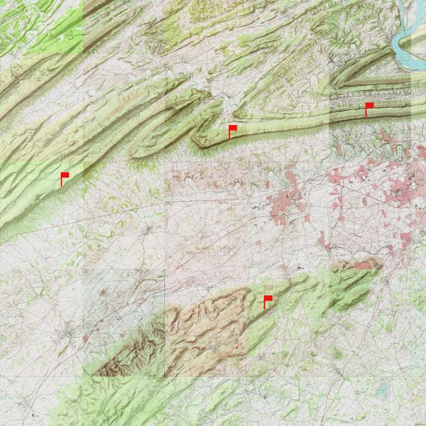
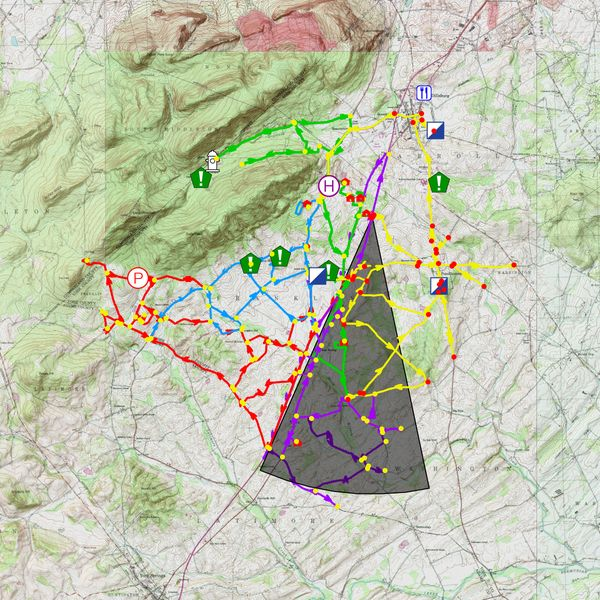

<div align="center">
  
</div>

<h1 align="center">EmComm Mapping Demo</h1>

<p align="center">
  <strong>QGIS for Emergency Communications — a starter kit for SMRA operators</strong><br>
  Who can talk to whom · Where stations and assets are · What happened after the net
</p>

<p align="center">
  <a href="https://www.qgis.org"></a>
  <a href="https://n3twt.org"></a>
  <a href="https://github.com/KC3DRU"></a>
  
  
  <a href="LICENSE"></a>
</p>

<p align="center">
  Companion files for the club presentation <em>“Intro to QGIS for Emergency Communications Mapping”</em>.<br>
  Clone this repo, open <code>EmComm_Planning_Map.qgz</code>, and you have a working map in about five minutes.
</p>

**Division of labour.** The [presentation](#the-presentation) is the *tutorial* — what a layer is, CRS,
symbology, the workflow, live demos. This README is the *repo*: what's in each file, how these layers were
actually built, and the gotchas. Where a slide covers something better, it's cited as *deck slide n* —
read the deck as [PDF](QGIS_EmComm_Mapping_Intro_v2.pdf), no LibreOffice required.

---

## Contents

- [What this is](#what-this-is)
- [Quick start](#quick-start)
- [What's in the repo](#whats-in-the-repo)
- [The sample project](#the-sample-project)
- [Walkthrough 1 — point-to-point contact map](#walkthrough-1--point-to-point-contact-map)
- [Walkthrough 2 — CERT drive route](#walkthrough-2--cert-drive-route)
- [Layer styling in this project](#layer-styling-in-this-project)
- [Handing off to CalTopo](#handing-off-to-caltopo)
  - [Two examples from the session](#two-examples-from-the-session)
- [The presentation](#the-presentation)
- [Notes & caveats](#notes--caveats)
- [Data sources worth knowing](#data-sources-worth-knowing)
- [Contributing & contact](#contributing--contact)
- [License & attribution](#license--attribution)

---

## What this is

A **real, working QGIS project** built from an actual SMRA exercise, packaged so any operator in the club can
open it, follow along with the slides, and then point it at their own data.

During the **July 2026 simplex test** handled out of the Cumberland County EOC, the question was simple:
*who could we actually hear?* A spreadsheet of callsigns and coordinates can answer that — a map answers it instantly.

<div align="center">
  
  <br><sub>Stations heard on the July 2026 net — one line per contact, radiating from the EOC.<br>
  Coordinates in this repo are fuzzed; see <a href="#notes--caveats">Notes &amp; caveats</a>.</sub>
</div>

QGIS **complements** the live tools rather than replacing them: YAAC / Xastir / APRSISCE for live APRS
positions, CalTopo for shared mobile maps, radio-specific tooling for coverage prediction. What QGIS is for is
the careful map — net and after-action mapping, station and asset locations, route planning — printed at 11×17
or exported for the field. Full comparison on *deck slide 8*.

---

## Quick start

1. **Install QGIS** (free) from [qgis.org](https://www.qgis.org) — Windows, macOS, Linux, even Raspberry Pi.
   This project was saved with **QGIS 3.44 Solothurn**; any recent 3.x will open it.
2. **Clone or download** this repository:
   ```bash
   git clone https://github.com/KC3DRU/EmComm-Mapping-Demo.git
   cd EmComm-Mapping-Demo
   ```
   > Keep the folder structure intact — the project references data with **relative paths** (`./Layers/...`).
   > Share the `.qgz` *together with* `Layers/` and the map works on someone else's machine.
3. **Double-click** `EmComm_Planning_Map.qgz` (or QGIS → *Project → Open*).
4. **Toggle layers** in the Layers panel. Turn basemaps on/off to reduce visual noise — OSM, USGS Topo, and
   ESRI World Hillshade are all included.
5. **Frame the data**: right-click a layer → *Zoom to Layer*, or use the **Zoom to Full Extent** toolbar button.

> **Internet required** for the three basemaps (online XYZ tile services). Your radio layers work offline
> regardless — pre-cache tiles or use a local GeoPackage/MBTiles before a deployment.

Optional, only for [Walkthrough 2](#walkthrough-2--cert-drive-route): the **Valhalla** routing plugin
(*Plugins → Manage and Install Plugins… → search “Valhalla”*).

**Project CRS:** `EPSG:4326` (WGS 84) — the same lat/lon datum your GPS and APRS use.

---

## What's in the repo

```text
EmComm-Mapping-Demo/
├── .gitignore                                 # Lock files, backups (keeps scratch data out)
├── LICENSE                                    # CC BY-SA 4.0
├── EmComm_Planning_Map.qgz                    # The QGIS project (layers, styles, CRS)
├── QGIS_EmComm_Mapping_Intro_v2.odp           # Club presentation (LibreOffice Impress)
├── QGIS_EmComm_Mapping_Intro_v2.pdf           # Same deck as PDF — easiest to read
├── Other_Instructions/                        # Written walkthroughs (PDF, screenshot-heavy)
│   ├── Point-to-Point Contact Map.pdf         # Contact lines + station dots from a spreadsheet
│   └── Creating a Drive Route for CERT.pdf    # Valhalla routing + task-instruction layer
├── Layers/                                    # Working data used by the project
│   ├── 20260716_EmComm_Net_EOC_South_Mountain.csv   # Net contacts as WKT linestrings
│   ├── OPERATORS.WKT                          # Station points (callsign + WKT POINT)
│   ├── EC_DRILL.WKT                           # Drill contacts (callsign + WKT + SIGNAL)
│   ├── Merged_Drill_Layers.geojson            # Merged input for network analysis
│   ├── ShortestPath.geojson                   # Output of the Shortest Path tool
│   ├── N3TWT_Repeaters.*                      # Club repeater points (ESRI Shapefile set)
│   └── TM Support Sites.sqlite                # County support-site points (SpatiaLite)
├── Exports/                                   # Sample exports for sharing / CalTopo
│   ├── Drill_Results_Sample.kml               # Net contacts → KML (21 lines)
│   ├── N3TWT_Repeaters.kml                    # Repeaters → KML (4 points)
│   ├── TMI_Support_Sites.kml                  # EMA support sites → KML (4 points)
│   ├── N3TWT_Repeaters.geojson                # Same layer as GeoJSON — the "title" label pattern
│   └── *.qmd                                  # QGIS layer definition metadata
└── assets/                                    # Images used by this README
```

Everything the demo needs is in `Layers/` — no database, no paid services. The whole net map runs on **one CSV**.

---

## The sample project

| Layer | Geometry | Source file | What it shows |
| :-- | :-- | :-- | :-- |
| `20260716_EmComm_Net_EOC_South_Mountain` | Lines | `Layers/…csv` | Every station worked on the July 2026 net, drawn from the EOC (21 features) |
| `OPERATORS` | Points | `Layers/OPERATORS.WKT` | Station locations labelled with callsigns |
| `EC_DRILL-KC3DRU Reports` | Lines | `Layers/EC_DRILL.WKT` | One operator's point-to-point drill results, with `SIGNAL` |
| `Merged Drill Layers` | Lines | `Layers/Merged_Drill_Layers.geojson` | All contact layers merged, ready for analysis |
| `Shortest path` | Line | `Layers/ShortestPath.geojson` | Best multi-hop route between two stations (relay planning) |
| `N3TWT_Repeaters` | Points | `Layers/N3TWT_Repeaters.shp` | Four club repeaters: `146.460`, `145.430`, `443.000`, `146.685 (DMR)` |
| `TMI Support Sites` | Points | `Layers/TM Support Sites.sqlite` | EOC, Shipp Univ. Recovery Center, Lower Allen Twp. Office, New Cumberland Bur. Off. |
| `OpenStreetMap` · `USGS topo` · `ESRI World Hillshade` | Raster tiles | Online XYZ | Interchangeable basemaps |

<div align="center">
  
  <br><sub>Merging contact layers and running <em>Shortest Path</em> answers: “what is the best simplex route to reach this station?”</sub>
</div>

---

## Walkthrough 1 — point-to-point contact map

> 📄 [`Other_Instructions/Point-to-Point Contact Map.pdf`](<Other_Instructions/Point-to-Point Contact Map.pdf>) — 8 pages, with screenshots
> Related: *deck slides 14–18* · produced [`Layers/EC_DRILL.WKT`](Layers/EC_DRILL.WKT) and [`Layers/OPERATORS.WKT`](Layers/OPERATORS.WKT)

Six moves, so you know what the PDF is for: build the geometry in the spreadsheet with two `=CONCATENATE()`
sections — a `LINESTRING(lon lat, lon lat)` per contact, from your position to each station you heard, plus
`CALLSIGN` for the label and `SIGNAL` for the category — save those three columns as CSV, fade the basemap
(OpenStreetMap at **50% transparency**), add it as a *Delimited Text* layer with **Geometry definition = WKT**
and geometry field `WKT`, then categorize symbology on `SIGNAL` and label with `CALLSIGN`. One row of that CSV:

```csv
CALLSIGN,WKT,SIGNAL
WB3FNJ,"LINESTRING(-77.16001461 40.21293984 , -77.166066 40.265184)",GOOD
```

**Gotchas that cost time** — the reason this section exists and the PDF doesn't:

- **Longitude first, latitude second**, space between them — that is WKT, and swapping them drops your station
  in the South Atlantic off Somalia.
- **Quote the WKT field** — it contains a comma. Leading spaces before the quote are tolerated; avoid them anyway.
- **Keep only the precision you have.** Four decimals ≈ 11 m, plenty for a net map. Six decimals is a claim you
  can't defend from a handheld.
- **Station dots** use the same recipe with `POINT(lon lat)` instead of `LINESTRING` — see `Layers/OPERATORS.WKT`.

---

## Walkthrough 2 — CERT drive route

> 📄 [`Other_Instructions/Creating a Drive Route for CERT.pdf`](<Other_Instructions/Creating a Drive Route for CERT.pdf>) — 6 pages, with screenshots
> Needs the **Valhalla** plugin · not covered in the deck

Routing a windshield-survey drive out of the EOC, then annotating it with task instructions.

**Drive the route**

1. Open the project, select the `CERT Routes` layer, click the **Valhalla** icon to open the side panel.
2. Enable the **Line** tool (top left) → green **+** to add waypoints; the yellow three-dot star marks them.
3. Set the profile to **Car** so you get driving directions.
4. Start at the EOC and click along **on roads**. **No more than 20 waypoints per session**, and don't space
   them too far apart or Valhalla will happily route you down roads that were never in your plan.
5. *Execute* → check the segment → red **X** to clear those waypoints → click where you left off and repeat.
6. Discard the waypoint layer when done; toggle the Valhalla segments on/off to confirm the order of travel.
7. Right-click segment 1 → **Make Permanent** → save as `CERT_Route_04.shp`. On segment 2, *Make Permanent* →
   pick the **same** file name → choose **Append**. Repeat for every segment.
8. `Layer → Add Layer → Vector` → reload `CERT_Route_04.shp` and give it a unique color (*Properties → Symbology*).

**Add the instructions layer**

1. `Layer → Create Layer → New Shapefile…` → e.g. `CERT_Route_Instructions_04.shp`, geometry type **Point**.
2. Add a field named `Task`, type **String**, length **120** → *Add to Fields List*.
3. Symbology: a color close to the route line. **Labels → Single Label → `Task`**, then enable **Buffer** (same
   HTML hex code as the symbol) and **Shadow** so the text reads over any basemap.
4. Toggle editing on (pencil) → the *three blue dots with an asterisk* tool → crosshair-click each spot that
   needs instructions.
5. `Layer → Open Attribute Table` to fix the wording afterwards.

---

## Layer styling in this project

The convention the shipped layers use, so a new layer you drop in reads the same way at a glance
(tutorial version on *deck slide 18*):

| Signal | Color | Meaning |
| :-- | :-- | :-- |
| Strong / `GOOD` | 🟢 Solid green, ~1 mm | Clear copy, reliable |
| Fair | 🟠 Amber | Usable with effort / QSB |
| Weak / `POOR` | 🔴 Red | Marginal — expect to need a relay |

Three classes, legend on the layout, callsign labels at the line endpoints. Under stress, in bad light, on a
printed page, subtle palettes fail.

---

## Handing off to CalTopo

Careful work in QGIS, live sharing in CalTopo (step-by-step on *deck slide 20*):

- Reproject to **WGS 84 (`EPSG:4326`)**, and make sure a `Name` field (KML) or `title` field (GeoJSON) holds your
  labels — [`Exports/N3TWT_Repeaters.geojson`](Exports/N3TWT_Repeaters.geojson) shows the pattern.
- Right-click layer → *Export → Save Features As…* → **GPX** (routes/tracks/waypoints), **KML** (all-round,
  keeps attributes) or **GeoJSON** (preserves the most structure).
- At [caltopo.com](https://caltopo.com): **Map Objects → Import** → tick features → *Import* → share by link or
  QR code so field teams see updates live.
- Routes as **GPX tracks**, resource locations as **GPX waypoints** or KML points, for the cleanest import.

### Two examples from the session

<table>
<tr>
<td valign="top" width="47%">

**▶ [N3TWT Presentation Map](https://caltopo.com/m/T04KS4T)** — `caltopo.com/m/T04KS4T`

<a href="https://caltopo.com/m/T04KS4T" title="Open in CalTopo"></a>

**Demo data, round-tripped.** Three layers from this project, exported from QGIS as **KML** and imported into
CalTopo: the July 2026 net contacts (`Exports/Drill_Results_Sample.kml`, 21 lines), the four club repeaters
(`Exports/N3TWT_Repeaters.kml`) and the TMI/EMA support sites (`Exports/TMI_Support_Sites.kml`) — the same
features, styled as they are here, on a phone in the field. The workflow above, end to end; click through to
pan, zoom and switch basemaps.

</td>
<td width="6"></td>
<td valign="top" width="47%">

**▶ [CERT_203 Routes](https://caltopo.com/m/F5DG58K)** — `caltopo.com/m/F5DG58K`

<a href="https://caltopo.com/m/F5DG58K" title="Open in CalTopo"></a>

**What it becomes.** The Township **CERT team's EOC map**, shown during the October session — primary
windshield survey routes, EMA sites and resources, repeater coverage. QGIS for the careful layer work, one
live shared picture for the net and the EOC. This is where [Walkthrough 2](#walkthrough-2--cert-drive-route) ends up.

</td>
</tr>
</table>

> Both are *live* CalTopo maps — they will change, and access may be limited to teammates. The thumbnails above
> are snapshots of the map previews (October 2026), basemap content © its providers. The maps are not part of
> this repo's files or its license; the KML/GeoJSON export is a one-way handoff. The three KML files behind the
> left-hand map are in `Exports/`; re-export any layer with *Export → Save Features As… → Keyhole Markup
> Language [KML]*. One thing to expect: **symbology does not survive the trip.** The exported
> `Drill_Results_Sample.kml` keeps the `SIGNAL` values but flattened all 21 lines to a single red, and the
> GeoJSON carries only a `title` label — recolor on the CalTopo side (which is where you want to be able to
> click a line and read its attributes anyway).

---

## The presentation

[`QGIS_EmComm_Mapping_Intro_v2.pdf`](QGIS_EmComm_Mapping_Intro_v2.pdf) — 27 slides, delivered to the club in
October 2026 by Rick Stoner, KC3DRU. Source deck in LibreOffice Impress:
[`QGIS_EmComm_Mapping_Intro_v2.odp`](QGIS_EmComm_Mapping_Intro_v2.odp).

Covers why maps matter in EmComm, what QGIS is and when not to reach for it, core GIS concepts (layers, vectors,
CRS, attributes, symbology, labels), the hands-on points-and-lines workflow with signal-strength styling and
shortest-path analysis, then data sources, offline use and next steps. Slides 10–13 are worth a look on their
own: they show how much the basemap choice changes the picture — aeronautical, nautical, geological, and an
azimuthal projection centered on your QTH.

---

## Notes & caveats

- **Coordinates are fuzzed.** Every lat/lon in this repo has been deliberately perturbed to protect operators'
  actual locations. The shapes, distances and lessons are real; the positions are **illustrative only** — do not
  use them for navigation, coverage prediction, or a real response.
- **Keep it that way when you contribute.** Fuzz anything you add (rounding to ~0.01° is usually enough for a
  club map), or use exercise locations instead of home QTHs.
- **Basemaps need internet.** OSM, USGS Topo and ESRI World Hillshade are online tile services — plan for this
  before an activation, and credit the provider on anything you publish.
- **One question per map, and date it.** Who could we hear / where are the shelters / which routes are open.
  Put an "as of" date/time on the layout; an undated map becomes a liability.
- **Third-party data.** Basemap tiles and county GIS downloads stay under their own terms; the club logo and the
  call sign N3TWT are not covered by the repo license (see [License](#license--attribution)).

---

## Data sources worth knowing

| Source | What you get |
| :-- | :-- |
| [OpenStreetMap](https://www.openstreetmap.org) | Free basemap data & tiles; cache them for offline use |
| [PASDA](https://www.pasda.psu.edu) | Free Pennsylvania GIS — counties, EOCs, flood, roads |
| [Cumberland County GIS](https://www.cumberlandcountypa.gov/3517/Map-Services) | Parcels, roads, buildings, emergency facilities |
| [York County GIS](https://york-county-pa-gis-portal-yorkcountypa.hub.arcgis.com/) | Same, one county over |
| [QuickMapServices](https://plugins.qgis.org/plugins/QuickMapServices/) | QGIS plugin — one click to dozens of basemaps |
| [Valhalla](https://plugins.qgis.org/plugins/valhalla/) | QGIS plugin — driving/cycling routing, used in Walkthrough 2 |
| GPX from handhelds / APRS exports | Track logs and waypoints straight into QGIS |
| Repeater directories / FCC data | Public databases → convert to a point layer |
| [ns6t.net azimuthal map](https://ns6t.net/azimuth/) | Generated hf/vhf azimuth map centered on your grid square |
| Your own digitizing | Click to add stations, draw contact lines |

---

## Contributing & contact

If you built a map for a net, exercise, or Field Day — put it in a branch and open a pull request. Especially
welcome:

- More net/exercise data (anonymized or generalized as the operator prefers)
- A ready-to-print 11×17 layout template for Cumberland County
- A repeater coverage layer, with tones and coverage caveats documented
- Offline tile-packaging notes for the county

**South Mountain Radio Amateurs (N3TWT)** — ARRL Special Service Club serving Carlisle, Camp Hill and Greater
Cumberland County, PA.

| | |
| :-- | :-- |
| 🌐 Club site | [n3twt.org](https://n3twt.org) |
| 📻 Nets & repeater tones | [n3twt.org/nets](https://n3twt.org/nets) |
| 🛡️ ARES / EmComm | [n3twt.org → ARES](https://n3twt.org) |
| 📍 Meetings | Cumberland County EOC, 1 Public Safety Drive, Carlisle, PA |
| ✉️ Project contact | Rick Stoner, KC3DRU — [github.com/KC3DRU](https://github.com/KC3DRU) |

---

## License & attribution

<p align="left">
  <a href="LICENSE"></a>
</p>

The presentation, QGIS project, and map data are licensed under **[CC BY-SA 4.0](LICENSE)** —
share and adapt freely, even commercially, if you credit the source and pass along the same license.

> EmComm Mapping Demo © 2026 Rick Stoner (KC3DRU) and the South Mountain Radio Amateurs (N3TWT).
> https://github.com/KC3DRU/EmComm-Mapping-Demo

**Not covered:** the club name, logo and call sign N3TWT; third-party basemap content
([OpenStreetMap](https://www.openstreetmap.org/copyright), [USGS](https://www.usgs.gov/information-policies-and-instructions/citations-acknowledgments),
[ESRI](https://www.esri.com/en-us/search/attribution)); and QGIS itself.

*Happy hunting — and may your next net map be a full one.* **73, Rick KC3DRU**
